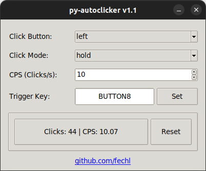

# Py-Autoclicker
**Py-Autoclicker** is a simple Python-based GUI application that simulates automatic mouse clicks with customizable modes and speed.




## Get Started
Clone the repository
```bash
git clone https://github.com/fechl/py-autoclicker.git
cd py-autoclicker
````
Install dependencies
```bash
pip install -r requirements.txt
```
Run the app
```bash
python main.py
```
